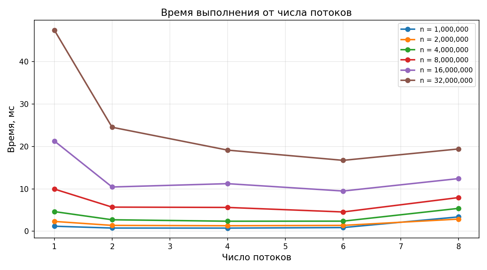
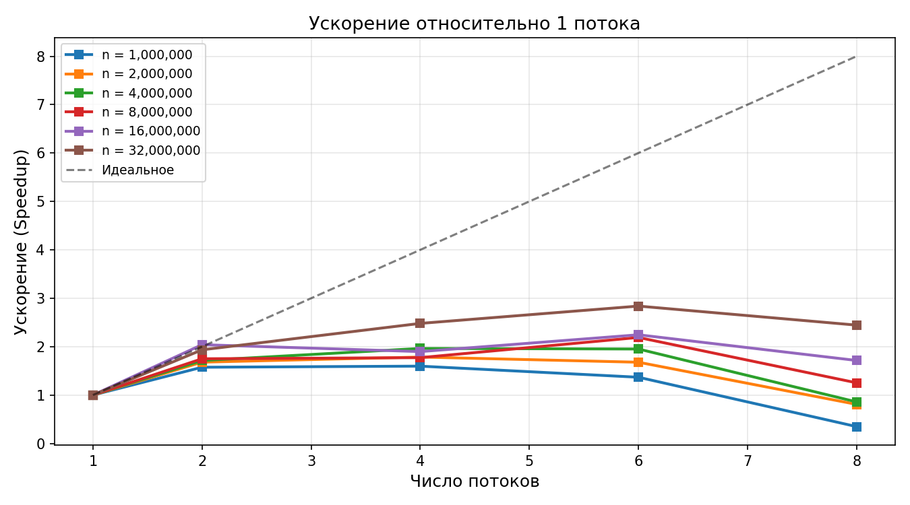
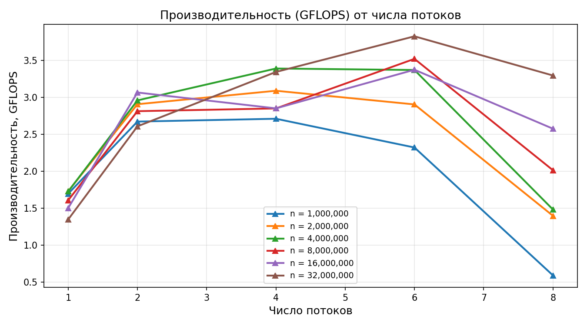

# Лабораторная работа №2: Параллельное скалярное произведение векторов (OpenMP)

## Описание

Параллельная реализация вычисления скалярного произведения двух векторов
с использованием технологии OpenMP. Проведена серия экспериментов с
различным числом потоков и размеров векторов.

## Конфигурация системы

- **Процессор:** Intel(R) Core(TM) i3-10100F
- **Архитектура:** Comet Lake (10-е поколение)
- **Физических ядер:** 4
- **Логических потоков:** 8 (4 ядра + Hyper-Threading)
- **Базовая частота:** 3.6 ГГц
- **ОС:** Windows 11 + WSL2 (Ubuntu 24.04 LTS)
- **Компилятор:** g++ 15.2.0 (WSL Ubuntu)
- **Флаги компиляции:** `-O2 -std=c++17 -fopenmp`
- **Тип данных:** `double`

## Методика эксперимента

- **Размеры векторов:** 1M, 2M, 4M, 8M, 16M, 32M
- **Количество потоков:** 1, 2, 4, 6, 8
- **Повторов:** 5 (берётся минимум времени)
- **Замер времени:** через `omp_get_wtime()`
- **Производительность:** `GFLOPS = 2·n / (time · 10⁹)`

## Проверка корректности

Сравнение с `numpy.dot` (BLAS) для всех запусков:

```
Maximum error: 1.711e-14
```

Результаты полностью совпадают с точностью машинного эпсилона `double`.

## Результаты экспериментов

### Время выполнения (мс)

| n | 1 поток | 2 потока | 4 потока | 6 потоков | 8 потоков |
|---|---------|----------|----------|-----------|-----------|
| 1 000 000 | 1.1781 | 0.7480 | **0.7374** | 0.8610 | 3.3821 |
| 2 000 000 | 2.3102 | 1.3751 | **1.2940** | 1.3764 | 2.8612 |
| 4 000 000 | 4.6294 | 2.7020 | **2.3583** | 2.3723 | 5.3942 |
| 8 000 000 | 9.9474 | 5.6845 | 5.6104 | **4.5416** | 7.9402 |
| 16 000 000 | 21.2888 | 10.4315 | 11.2176 | **9.4798** | 12.4166 |
| 32 000 000 | 47.4497 | 24.5256 | 19.1292 | **16.7170** | 19.4080 |

### Ускорение (Speedup)

Относительно 1 потока:

| n | 2 потока | 4 потока | 6 потоков | 8 потоков |
|---|----------|----------|-----------|-----------|
| 1 000 000 | 1.58 | 1.60 | 1.37 | 0.35 |
| 8 000 000 | 1.75 | 1.77 | 2.19 | 1.25 |
| 16 000 000 | 2.04 | 1.90 | 2.25 | 1.71 |
| 32 000 000 | 1.93 | 2.48 | **2.84** | 2.45 |

### Производительность (GFLOPS)

| n | 1 поток | 2 потока | 4 потока | 6 потоков | 8 потоков |
|---|---------|----------|----------|-----------|-----------|
| 1 000 000 | 1.70 | 2.67 | **2.71** | 2.32 | 0.59 |
| 8 000 000 | 1.61 | 2.81 | 2.85 | **3.52** | 2.02 |
| 32 000 000 | 1.35 | 2.61 | 3.35 | **3.83** | 3.30 |

## Графики







## Выводы

1. **Программа работает корректно** — максимальная погрешность относительно
   `numpy.dot` составила `1.7e-14` (машинный эпсилон `double`).

2. **Наилучшая производительность** — на **4 и 6 потоках**:
   - 4 потока — соответствуют числу **физических ядер**.
   - 6 потоков — показывают лучший результат на больших `n` (32M).
   - Пик: **3.83 GFLOPS** при `n = 32M` на 6 потоках.
   - Ускорение относительно 1 потока: **2.84×**.

3. **Использование 8 потоков ухудшает результат** на малых размерах
   (1M–4M) из-за Hyper-Threading: два логических потока делят одно
   физическое ядро, конкурируя за кэш и исполнительные блоки.

4. **Задача memory-bound** — скалярное произведение читает `16n` байт
   из памяти при `2n` арифметических операциях. Узким местом становится
   **пропускная способность ОЗУ**, а не CPU. Поэтому ускорение ограничено
   (~2.8× вместо идеальных 4×).

5. **Оптимальное число потоков** для данной задачи — **4 (по числу
   физических ядер)**. Дальнейшее увеличение не даёт выигрыша.

## Структура

```
lab2/
├── dot_product_omp.cpp    # Параллельная реализация
├── generate_data.py       # Генератор тестовых данных
├── verify.py              # Верификация через NumPy
├── benchmark_omp.py       # Автоматизация экспериментов
├── plot_omp.py            # Построение графиков
├── Makefile               # Сборка
├── README.md              # Этот файл
└── REPORT.md              # Подробный отчёт
```

## Требования

- Компилятор C++ с поддержкой C++17 (GCC / Clang)
- `make`
- OpenMP
- Python 3.10+ с пакетами `numpy`, `matplotlib`

## Быстрый старт

```bash
make
python3 generate_data.py 4000000 input.txt
./dot_product_omp input.txt output.txt 4
python3 verify.py input.txt output.txt
```

## Полный эксперимент

```bash
python3 benchmark_omp.py
python3 plot_omp.py
```

Результаты сохраняются в `results.csv` и `*.png`.
